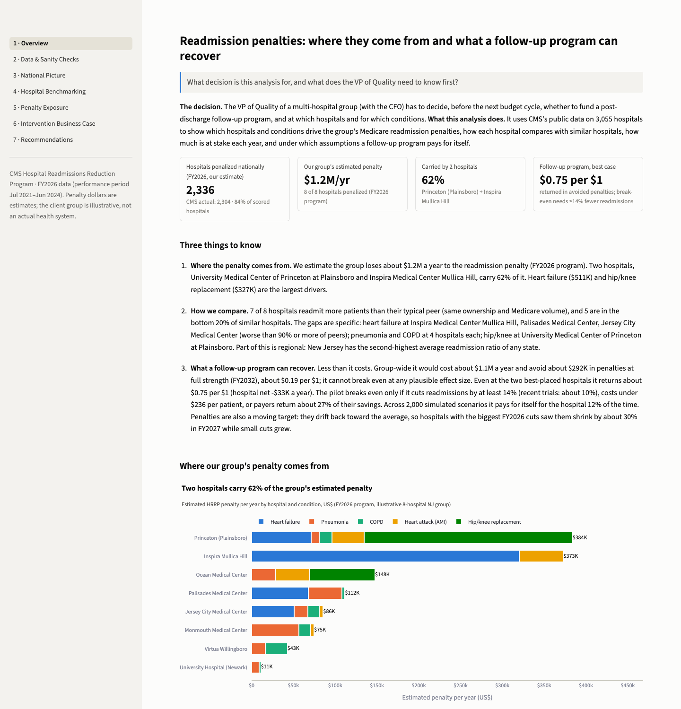
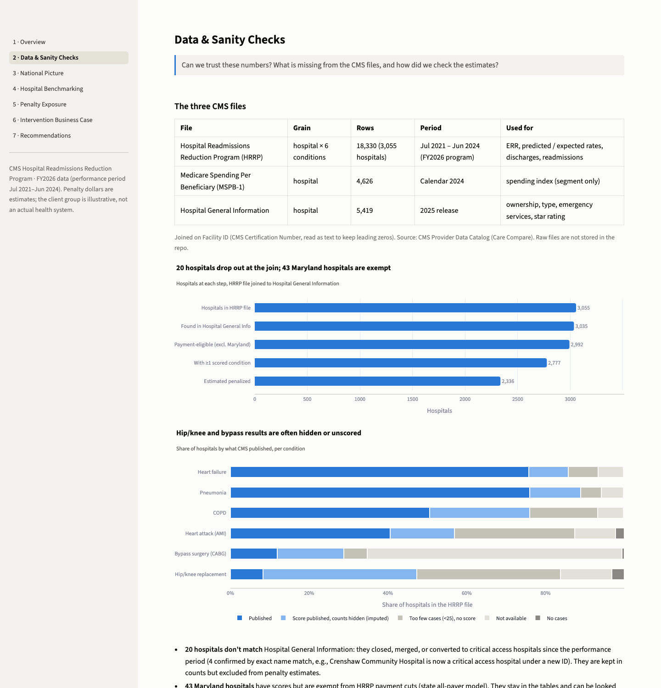
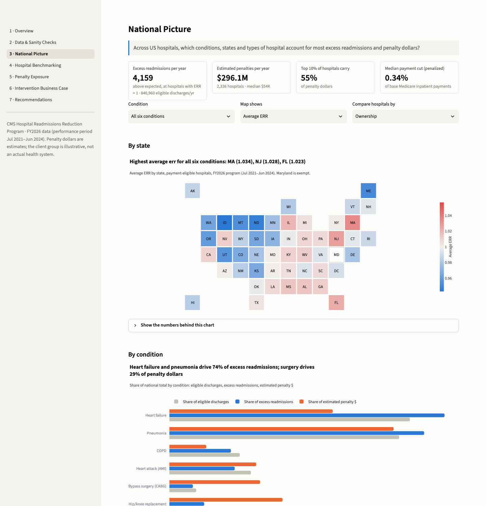
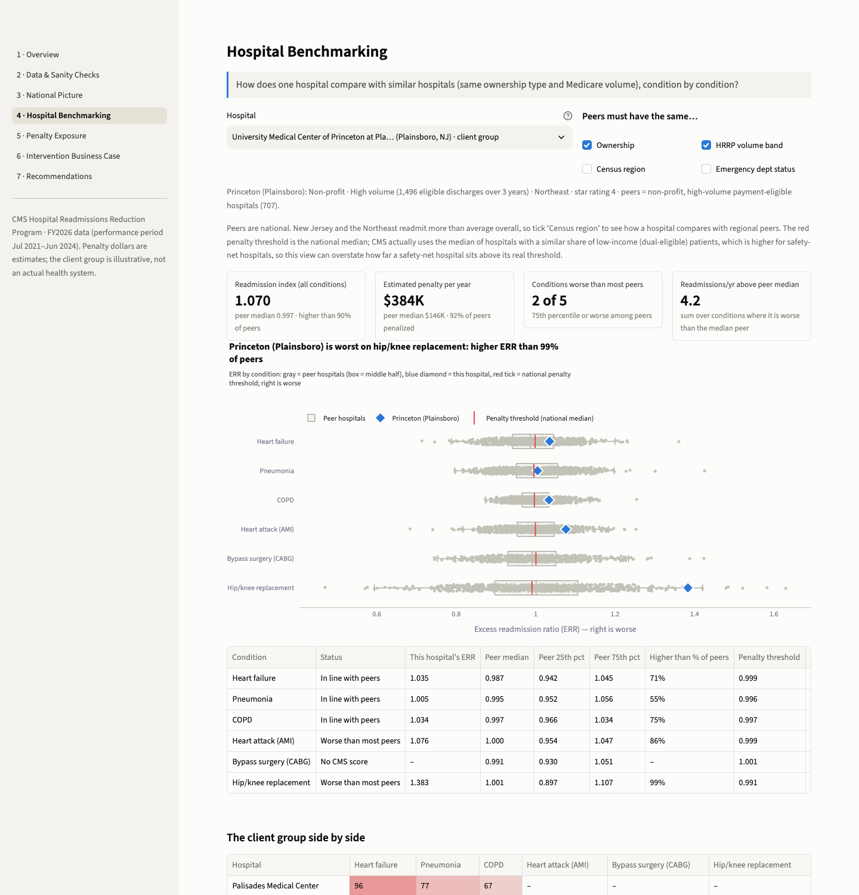
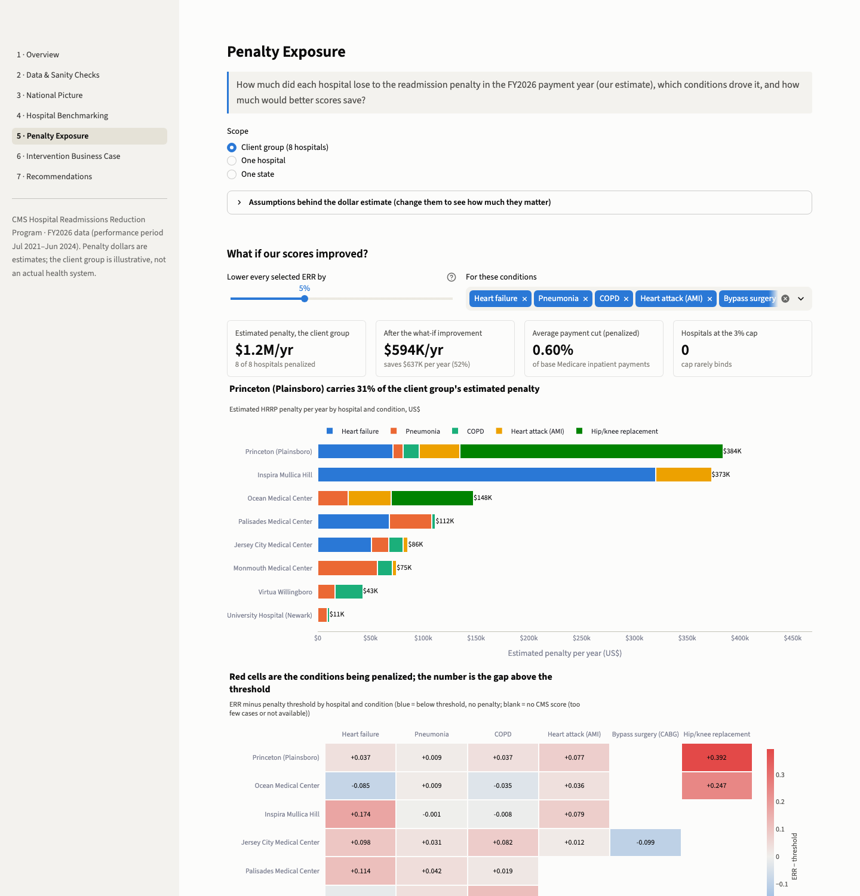
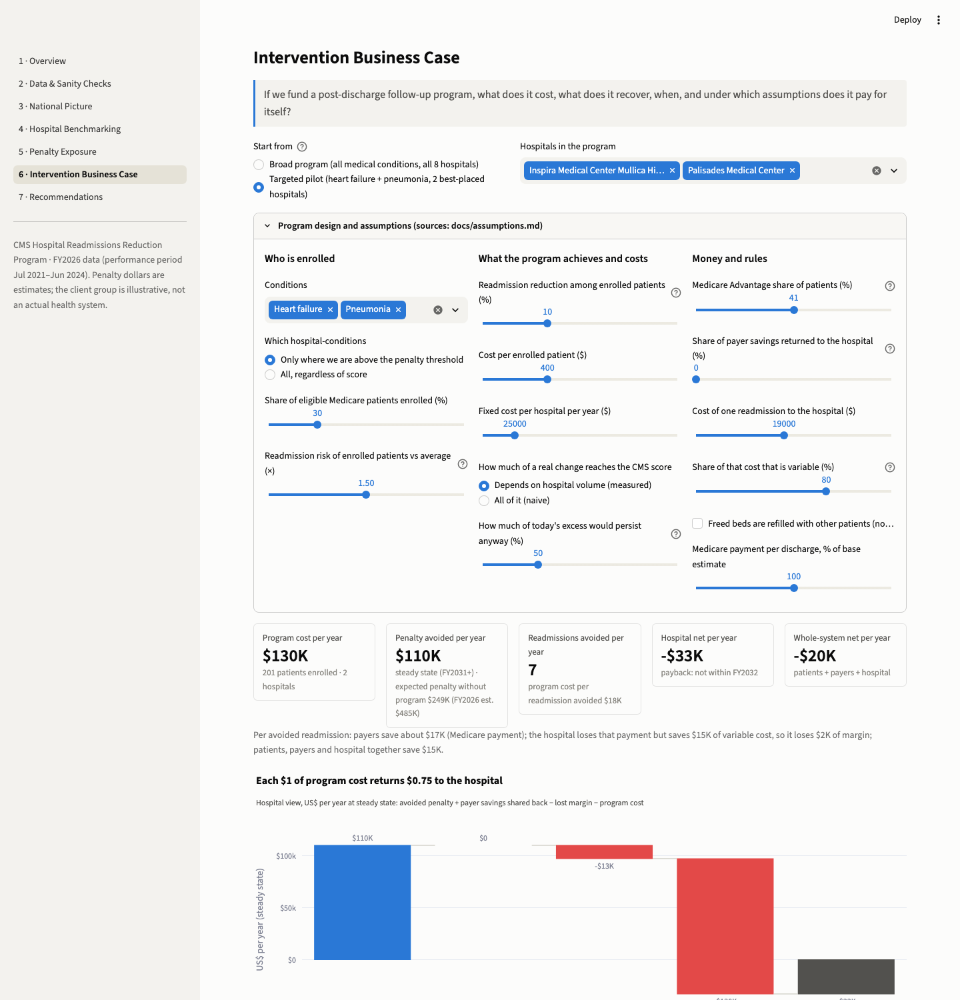
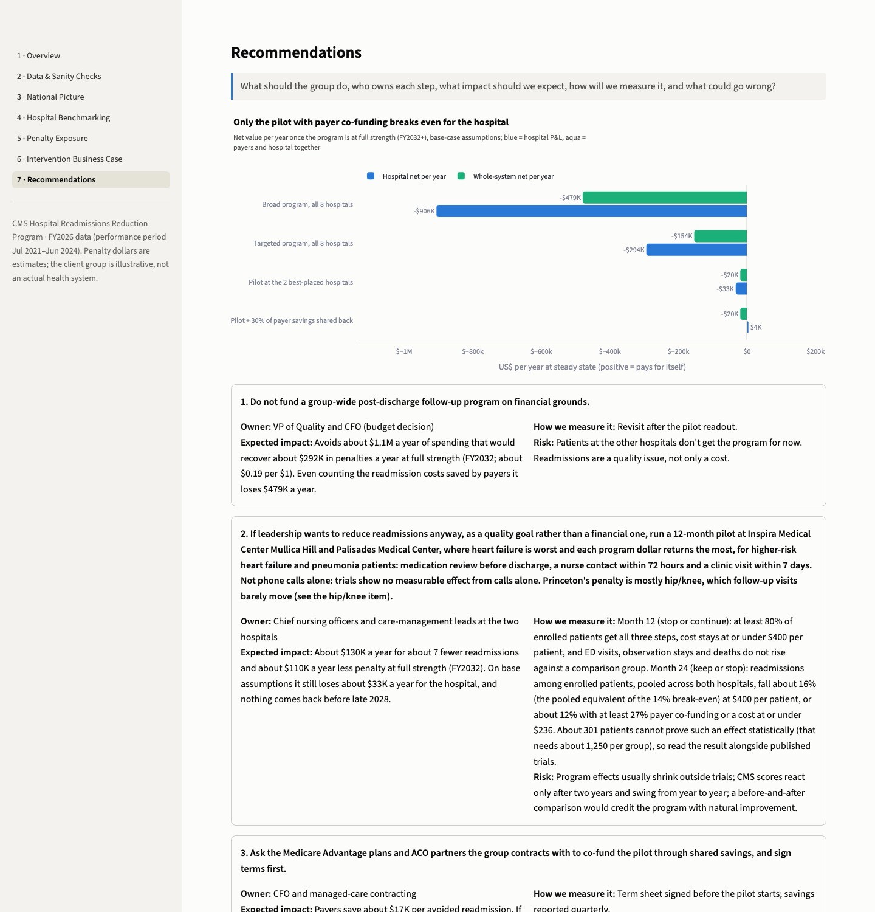

# Hospital Readmission Penalties: Benchmarking & Business Case

**Problem:** an 8-hospital group lost an estimated $1.2M to Medicare's readmission penalty in the FY2026 payment year (CMS's FY2027 cuts are lower, about $0.4M) and must decide whether to fund a post-discharge follow-up program. **Finding:** two hospitals carried 62% of the FY2026 penalty; a group-wide program would cost about $1.1M a year to recover about $0.3M. **Recommendation:** don't fund it on financial grounds. If leadership wants to act on quality, run a two-year pilot at 2 hospitals with a stop/continue checkpoint at month 12 (about $90K in the first year, $130K a year at full size), with shared-savings terms signed first.

Built on CMS public data for 3,055 US hospitals (FY2026 Hospital Readmissions Reduction Program, discharges July 2021 – June 2024) with SQL (DuckDB), Python and Streamlit. The "group" is an **illustrative set of 8 New Jersey hospitals** drawn by a fixed, seeded rule, not an actual health system; the owners named in the recommendations are illustrative roles.

## The business problem

> *"Several of our hospitals are about to be hit with CMS readmission penalties again. Which hospitals and which conditions are dragging us down? Where do we fall short compared with similar hospitals? If we invest in a post-discharge follow-up program, how much could we recover?"* (VP of Quality)

**Decision:** whether to fund the program, where, and at what budget, before the next budget cycle ([request and scope](docs/01_request_and_scope.md)).

## Three findings

1. **The penalty is concentrated.** The group lost an estimated **$1.2M** in the FY2026 payment year, and **two hospitals carried 62%**. Heart failure ($511K) and hip/knee replacement ($327K) are the largest drivers. CMS's FY2027 cuts, already set, come to about $0.4M on the same payment base, now led by Palisades. Nationally we estimate **2,336 hospitals penalized** (CMS's actual count: 2,304) and **$296M a year** in penalties, with the top 10% of hospitals carrying 55%. Heart failure and pneumonia produce 74% of excess readmissions, while bypass and hip/knee surgery generate 29% of penalty dollars from 13% of discharges: CMS charges about **$217K per extra hip/knee readmission vs $42K for heart failure**.
2. **The gaps are hospital- and condition-specific.** **7 of 8** client hospitals readmit more than their typical peer (same ownership and Medicare volume), and **5 are in the bottom 20%**. Heart failure at three hospitals is worse than at 90%+ of peers. One hospital's hip/knee ratio (1.38) is worse than at 99% of peers.
3. **A follow-up program would not pay for itself through penalties.** Group-wide it would cost about **$1.1M a year** and avoid about **$0.29M** in penalties at full strength (from FY2032), **$0.19 per $1**. It cannot break even at any plausible effect size: it would need to cost under $8 per patient. Even the best-placed pilot returns **$0.75 per $1** (hospital net −$33K a year). It breaks even only if readmissions among enrolled patients fall about **16%** (a 14% base effect, with heart failure at 1.2×; recent trials: about 11%), the cost is **≤ $236 per patient**, or about **27% of payer savings** comes back. Across 2,000 simulated scenarios the pilot pays for itself for the hospital **12%** of the time (median −$54K a year). Of the ±30% changes, only one flips the pilot for the hospital: Medicare payment per discharge 30% higher brings it to break-even (+$66 a year). Our payment base is on the low side (national total $296M vs CMS's $316M–$361M), but our single national threshold overstates the group's penalty ($1.23M vs $1.04M at CMS's actual cuts), so the two biases partly offset. Penalties also drift back toward the average: hospitals with the biggest FY2026 cuts saw them shrink by about 30% in FY2027, while small ones grew.

## Recommendations

| Who | What | Expected impact | How we measure it | Risk |
|---|---|---|---|---|
| VP of Quality, CFO | Don't fund a group-wide program on financial grounds | Avoids ~$1.1M/yr of spend for ~$0.29M/yr of penalty relief | Revisit after the pilot | Fewer patients helped this year |
| CNOs at Inspira Mullica Hill and Palisades | Quality-driven two-year pilot (stop/continue checkpoint at month 12) for higher-risk heart failure and pneumonia patients: medication review, nurse contact ≤72 h, clinic visit ≤7 days (not phone-only) | ~7 fewer readmissions/yr and ~$110K/yr less penalty at full strength (FY2032), for ~$90K in year 1 and ~$130K/yr at full size; still −$33K/yr for the hospital, nothing back before late 2028 | Month 12: ≥90 enrolled, ≥80% get all three steps, variable cost ≤$400/patient, no rise in ED visits, observation stays, deaths or readmissions vs a concurrent comparison group. Month 24: keep only if readmissions among enrolled patients fall ~16% vs that group at ≤$400/patient (the 14% base effect, with heart failure at 1.2×), or ~12% with ≥27% of all payer savings returned at ≤$400/patient, or ~12% at ≤$236/patient. ~300 patients cannot prove this statistically (needs ~1,250 per group) | Effects shrink outside trials; CMS scores lag two years; the second site rests on our threshold proxy (on CMS's peer-group thresholds the pilot returns $0.66 per $1 and Palisades ranks 5th of 8), so confirm both sites with CMS's Hospital-Specific Reports |
| CFO, managed-care contracting | Ask the Medicare Advantage plans and ACO partners the group contracts with to share savings; sign terms before launch | Pilot breaks even at a ~27% share | Signed terms | Plans may decline; ACO savings are settled on total cost, not per readmission. The 27% is of all payers' savings, 59% of which are traditional Medicare's (shared only through Medicare's own programs, such as ACOs); from MA plans alone it would take ~65% of theirs |
| Orthopedics chair | Review recent hip/knee readmissions at Princeton (Plainsboro) before spending | Hip/knee drove ~$250K of the FY2026 estimate; forward exposure likely lower | Quarterly case review; re-check with FY2027 data | May already be easing (FY2027 cut fell to 0.04%) |
| Quality analytics | Track readmissions monthly; refresh when CMS posts FY2027 data (early 2027) | Early warning; sepsis enters the penalty in FY2030 | Monthly dashboard | Rule changes break year-to-year comparability |

Full detail: [business case](docs/business_case.md) · [benchmarking](docs/benchmarking.md) · [one-page memo](docs/readout.md) · [standalone HTML report](reports/report.html).

## The dashboard

`streamlit run dashboard/app.py`. Seven pages in storyline order. Each opens with the question it answers and ends with a plain-language "How to read this". Pages 4–6 recalculate live as you change the peer definition, assumptions or program design.

| | |
|---|---|
| **1 · Overview:** the decision, three findings, where the group's penalty comes from  | **2 · Data & Sanity Checks:** join funnel, missing-value reasons, 37 automated checks, validation against CMS, measured shrinkage  |
| **3 · National Picture:** state tile map, condition mix, segments with 95% intervals, concentration, adjusted associations  | **4 · Hospital Benchmarking:** any hospital vs peers you define, by condition  |
| **5 · Penalty Exposure:** dollars by hospital and condition, threshold heatmap, what-if, volatility  | **6 · Intervention Business Case:** presets and sliders, waterfall, year-by-year cash, tornado, break-even map, Monte Carlo  |
| **7 · Recommendations:** options compared, owner/impact/measure/risk, evaluation design  | |

## How the numbers were built

- **Data.** Three CMS Care Compare files joined on the CMS Certification Number: the HRRP file (18,330 rows = 3,055 hospitals × 6 conditions), Medicare Spending per Beneficiary (CY2024) and Hospital General Information. SQL models (`sql/01–09`, DuckDB) land, type and join them. Every blank value has a reason (a CMS footnote or small-cell suppression). **30 checks pass, 7 are documented warnings, 0 fail** ([data-quality checks](docs/03_data_quality_checks.md), [metric definitions](docs/02_metric_definitions.md)).
- **Penalty estimate.** CMS's payment formula: 0.9627 × Σ condition payments × max(ERR − threshold, 0), capped at 3%. The national median ERR stands in for CMS's dual-eligible peer groups. Payment per case comes from FY2026 IPPS rates scaled by CMS's published cohort payment ratios. The formula runs in SQL and in Python, and the two agree to the cent. **Checked against CMS's actual FY2026 decisions:** our estimated payment cut correlates **r = 0.92** (rank 0.94) with CMS's (partly in-sample: three national inputs come from the same CMS release), the mean cut among penalized hospitals is 0.46% vs CMS's 0.44%, and we make the same penalized-or-not call for 97.1% of hospitals (for context, 84% of scored hospitals are penalized).
- **Shrinkage.** CMS's model pulls small hospitals toward average. Measured from the published data (R² ≥ 0.99), only about 20% of a real heart-failure improvement reaches the score at 100 discharges, vs about 80% at 1,500. The business case gives small hospitals this partial credit.
- **Benchmarking and drivers.** Peers share ownership and HRRP volume band. Segment averages carry 95% intervals. A regression with hospital-clustered errors gives adjusted associations, not causes.
- **Business case.** Applies the FY2027 rules (FY2026 IPPS final rule): a 2-year window, and Medicare Advantage patients counted in the score but not in the penalty base. The baseline forecasts regression to the mean. One consistent set of money flows covers the payer, hospital and whole-system views. Effects and costs are anchored on trials and economic reviews (Cochrane 2022, Leppin 2014, PACT-HF 2019, Nuckols 2017). Includes a ±30% sensitivity table, tornado, break-even map, a 2,000-run Monte Carlo with a fixed seed, and a power check for the pilot ([assumptions log](docs/assumptions.md)).

## Assumptions and limitations

- Hospital-level public data show **where** readmissions are high, not **why**; differences between groups are associations.
- Penalty dollars are estimates. Exact payments are not public, so single-hospital dollars carry roughly ±30% uncertainty. The national total ($296M) sits below CMS's nearest published totals ($316M–$361M).
- A single national threshold overstates penalties at safety-net hospitals. In this group that matters most at University Hospital (Newark): we estimate a 0.34% cut where CMS applied 0.05%, about $11K, so no conclusion about the group's penalty changes. It does matter for the pilot's second site: on CMS's peer-group thresholds the pilot returns $0.66 per $1 (not $0.75) and Palisades ranks 5th of 8, so confirm both sites with CMS's Hospital-Specific Reports before launch.
- Scores are from the FY2026 program; FY2027 (in effect now) counts Medicare Advantage patients over two years. CMS's FY2027 cuts for the group (about $0.4M on our payment base) are already below the business case's FY2029+ baseline ($0.64M), with Palisades now the largest. Refresh when CMS posts FY2027 condition-level data (early 2027).
- Program effects come from trials and usually shrink in practice. The base case uses a 10% reduction, a little below recent trials (about 11%), and a pilot of this size can confirm cost and delivery but cannot prove the readmission effect on its own.

## How to run

Requires Python 3.12, [uv](https://docs.astral.sh/uv/) (or plain `pip`) and three CSV files from the CMS Provider Data Catalog, saved in one folder under these names: `hrrp_readmissions.csv` (*Hospital Readmissions Reduction Program*, dataset 9n3s-kdb3), `medicare_spending_per_beneficiary.csv` (*Medicare Spending Per Beneficiary – Hospital*, rrqw-56er) and `hospital_general_information.csv` (*Hospital General Information*, xubh-q36u). Raw data are never committed.

```bash
git clone https://github.com/edwinzhang98/healthcare-cost-analysis.git
```
```bash
cd healthcare-cost-analysis && uv venv --python 3.12 && uv pip install -r requirements.txt
```
```bash
.venv/bin/python run.py
```
```bash
.venv/bin/streamlit run dashboard/app.py
```

- **Data location:** by default the three CSVs are read from `~/projects/data-projects/datasets/p4-cms-2025` (`data.raw_dir` in `config.yaml`). To use another folder, change that one line, or leave the file alone and set `CMS_RAW_DIR=/path/to/folder` in a `.env` file (copy `.env.example`) or on the command line (`CMS_RAW_DIR=/path/to/folder .venv/bin/python run.py`). Relative paths are read from the repo root.
- `python run.py` runs everything in under a minute: SQL models → cached tables (`data/processed/*.parquet`) → analysis (`reports/key_metrics.json`) → `reports/report.html` and `reports/memo.html` → executed notebooks exported to `reports/*.html`. Use `--skip-notebooks` for a faster run, or `make all` / `make quick`.
- **Optional external check** against CMS's actual penalties: `python run.py --validate` downloads CMS's FY2026/FY2027 penalty files to `data/external/`. They are used only for testing; summary results are committed in `reports/tables/`. Run `python run.py --validate` once to reproduce the committed report and dashboard in full: without it the hospital-level validation scatter (report §3, dashboard page 2) and the FY2026→FY2027 persistence chart (report §6, dashboard page 5) are left out, with a note saying so.
- Each SQL file runs on its own against the warehouse (`python -m src.sql_runner sql/05_fct_hospital_condition.sql` or `duckdb data/warehouse.duckdb -f sql/05_fct_hospital_condition.sql`). Inputs and outputs are listed in each file's header.
- Screenshots: `uv pip install -r requirements-dev.txt && playwright install chromium && python scripts/screenshots.py`.

## Repository

```
sql/          DuckDB models: raw -> staging -> fact/dim -> penalty & segment marts -> data-quality checks
src/          config, SQL runner, penalty model, shrinkage, benchmarking, drivers, cost model, charts,
              analysis build, recommendations, CMS validation, report and memo builders
dashboard/    Streamlit app (app.py + views/p1..p7)
notebooks/    01_data_quality, 02_analysis, 03_cost_model (executed, with outputs)
reports/      report.html, memo.html, notebook HTML exports, key_metrics.json, tables/
docs/         plan, request & scope, metric definitions, data-quality checks, assumptions,
              benchmarking, business case, readout memo, img/ (screenshots)
seeds/        condition parameters (labels, payment per case)       scripts/  screenshot capture
run.py        one-command pipeline       config.yaml  paths and every model parameter
```

## About this project

Independent portfolio project: an illustrative hospital group built from CMS public data, worked the way a hospital quality or healthcare consulting team would. All data are public; no patient-level data are used.
