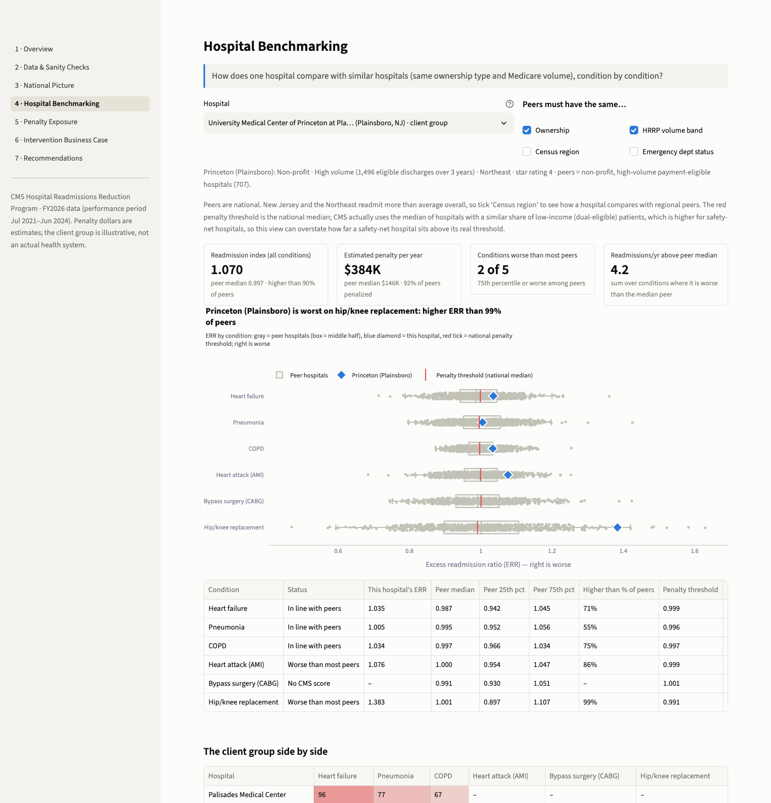

# Benchmarking: Princeton (Plainsboro) vs similar hospitals

One hospital's readmission results, condition by condition, against hospitals of the same type, ownership group and HRRP volume band; then the whole client group side by side.

| | |
|---|---|
| **Target** | University Medical Center of Princeton at Plainsboro (CCN 310010), NJ: the largest estimated penalty in the client group |
| **Client group** | 8 New Jersey hospitals drawn by a seeded, volume-stratified rule (`src/client.py`). Illustrative, not an actual health system; no relationship with these hospitals is implied |
| **Data** | CMS FY2026 HRRP file (traditional Medicare, age 65+, discharges July 2021 – June 2024) and Hospital General Information |
| **Penalty dollars** | Our estimate: CMS's formula with a national-median threshold. It makes the same penalized-or-not call as CMS's actual FY2026 decisions for 97% of hospitals |

Numbers come from `reports/key_metrics.json`; footnotes explain the rest. Code: `src/benchmarking.py`.

## 1. Bottom line

- **Princeton (Plainsboro) readmits more than about 90% of similar hospitals.** Its readmission index is 1.070 against a median of 0.997 for its 707 peers (non-profit, High volume). Every condition CMS scored is above the penalty threshold, true of only 6% of peers, and the estimated penalty ($384K a year) is 2.6 times the peer median ($146K). Against Northeast peers, who readmit more, it ranks at the 80th percentile.
- **Most of the gap is a few hip/knee readmissions.** The hip/knee ERR (1.38) is higher than 99% of peers but rests on 16 readmissions among 164 discharges over three years, against about 9 expected: roughly 2 extra a year. That carries $249K (65%) of our FY2026 estimate and about two-thirds of CMS's actual FY2026 cut (0.88%). Forward exposure is likely lower: CMS's FY2027 cut fell to 0.04%, and extreme results drift back toward the average (section 7).
- **The other conditions are close to peers.** Heart attack (86th percentile) is the only other one worse than most peers, and that status hinges on about 2 readmissions over three years. Heart failure (71st) has the largest gap in patients because of its volume: about 3 readmissions a year.
- **For action:** a case review for hip/knee rather than a new program. Across the group, the strongest case for a follow-up program is heart failure at Inspira Mullica Hill and Palisades, then Jersey City.

## 2. Who the peers are

A peer is payment-eligible (outside Maryland, which is exempt from HRRP payment cuts, and listed in Hospital General Information), has at least one ERR (CMS publishes one only with 25 or more eligible discharges; CMS HSR user guide), and shares the target's ownership group (Non-profit, For-profit or Government; `sql/04_stg_hospital_info.sql`) and HRRP volume band (eligible traditional-Medicare discharges for the six conditions over three years: High 1,000 or more, Mid 400–999, Low under 400).[^vol] Hospital type is the same by construction: HRRP covers only short-term acute care hospitals paid under the inpatient prospective payment system (42 U.S.C. 1395ww(q)), and all 2,777 scored payment-eligible hospitals are "Acute Care Hospitals". The target is never its own peer.

**Princeton's peers (FY2026):** 2,777 payment-eligible hospitals with an ERR → 1,787 non-profit, excluding the target → **707 also High volume (default peers)** → 174 also in the Northeast (section 5a). The median peer had 1,628 eligible discharges over three years (middle half 1,260–2,243); the target had 1,496. Peers span all four census regions; 32 are in New Jersey and 96% have an emergency department. A peer counts for a condition only if it has an ERR for it: from 520 peers for bypass to 704 for heart failure and pneumonia.

- **Why volume band, not beds.** The CMS files have no bed count, and volume matters more: CMS's model pulls hospitals with few cases toward 1.00 (section 5c), so ERRs spread more in the High band (standard deviation 0.095) than in the Low band (0.059).[^sd] Within one band, scores rest on similar amounts of data. The band is not size: it counts traditional-Medicare patients aged 65+ in six conditions, so payer mix and service lines matter too. University Hospital (Newark), state-owned, is Low volume with 147 eligible discharges, and 41% of New Jersey's Medicare beneficiaries were in Medicare Advantage in 2025 (RUPRI Center 2026), outside the FY2026 scores.
- **Why ownership as well.** After adjustment for condition, region, emergency department and spending, for-profit hospitals average 1.4 ERR points (0.014) above non-profits (95% CI 0.9 to 2.0), while High- and Mid-volume hospitals differ by 0.04 points (95% CI −0.41 to 0.49). These are associations. Matching on ownership removes a difference in averages; matching on volume, a difference in spread.

## 3. Condition by condition

Table 1. Princeton (Plainsboro) vs its 707 peers. ERR = predicted ÷ expected readmission rate. Percentile = share of peers with a lower ERR; **bold** = 75 or higher, "worse than most peers" (25 or lower = better than most). Expected = discharges × CMS's expected rate. Gap = readmissions a year above the peer median, as the *score* counts it (annual discharges × expected rate × (ERR − peer median), from `benchmark()`) and in *actual* readmissions (score ÷ pass-through, Table 5). Penalty = our FY2026 estimate; thresholds are in Table 4.

| Condition | ERR | Peer median (25th–75th) | Percentile | Discharges, 3 yr | Readmissions, observed / expected | Gap per yr, score / actual | Est. penalty per yr |
|---|---|---|---|---|---|---|---|
| Hip/knee replacement | 1.3835 | 1.001 (0.897–1.107) | **98.8** | 164 | 16 / 8.8 | 1.1 / 2.4 | $249K |
| Heart attack (AMI) | 1.0763 | 1.000 (0.954–1.047) | **86.4** | 119 | 21 / 16.0 | 0.4 / 1.7 | $39K |
| COPD | 1.0337 | 0.997 (0.966–1.034) | 74.9 | 171 | 35 / 31.5 | 0.4 / 1.3 | $15K |
| Heart failure | 1.0354 | 0.987 (0.942–1.045) | 71.2 | 716 | 138 / 130.9 | 2.1 / 3.2 | $71K |
| Pneumonia | 1.0048 | 0.995 (0.952–1.056) | 55.4 | 326 | 49 / 48.5 | 0.2 / 0.4 | $9K |
| Bypass surgery (CABG) | no result | 0.991 (0.930–1.051) | – | – | – | – | $0 |
| **Total** | | | | **1,496** | **259 / 235.7** | **4.2 / 9.0** | **$384K** |

- **Hip/knee.** A 9.8% readmission rate against 5.4% expected: about 7 extra over three years, roughly 2 a year. At this volume the score credits about half of the gap (pass-through 0.46). Because the formula multiplies the gap above the threshold by the payments for all hip/knee discharges, these few readmissions cost an estimated $249K a year (FY2026); at the peer median the penalty would have been about $7K. Nationally our model charges about $217K per hip/knee readmission above the threshold, about 18 times Medicare's payment for the stay ($12,062; [assumptions](assumptions.md) B3), against 4.9 times for heart failure. MedPAC reported more than 20 times for hip/knee under the formula used before FY2019 (MedPAC 2018).
- **Heart attack.** 21 readmissions on 119 discharges (17.6%) against 16 expected. The score credits only about a quarter of the gap (ERR 1.08, $39K a year), and the status is fragile: one fewer readmission over three years gives the 82nd percentile, two fewer the 74th, five fewer the peer median.[^cnt]
- **COPD.** The 74.9th percentile, just under the cut-off; it crosses 75 under three of the five other peer definitions (Table 3).
- **Heart failure.** 19.3% against 18.3% expected. Not unusual among peers (71st percentile), but high volume makes it the largest gap in patients (about 2 a year in the score, 3 actual) and the condition where an actual improvement reaches the score most (pass-through 0.66).
- **Pneumonia.** About as expected; the ERR of 1.005 is just above the threshold (0.996), adding $9K a year.
- **Bypass.** CMS footnote 5: results not available for this reporting period (CMS footnote crosswalk), so no score and no penalty.



## 4. Hospital-level summary

Table 2. Princeton (Plainsboro) vs its 707 peers, all conditions. Readmission index = discharge-weighted mean ERR. Penalty = our FY2026 estimate. Percentile = share of peers with a lower value.

| Measure | Princeton (Plainsboro) | Peer median | Peer 25th–75th | Percentile |
|---|---|---|---|---|
| Readmission index | 1.070 | 0.997 | 0.959–1.036 | 89.8 |
| Estimated penalty, $ per year | $384K | $146K | $47K–$292K | 82.3 |
| Estimated payment cut (% of base DRG payments) | 1.08% | 0.34% | – | – |
| Scored conditions above the penalty threshold | 5 of 5 | 3 | – | – |

- **A penalty is normal here; one this large is not.** We estimate that 92% of peers are penalized (84% of scored hospitals nationally), but only 6% have every scored condition above the threshold.
- **The penalty ranks lower than the index (82nd vs 90th percentile)** because many peers treat more traditional-Medicare patients (median 1,628 discharges vs 1,496), so the same ERR gap costs them more.
- **CMS's actual figures point the same way:** a 0.88% cut in FY2026 (our estimate 1.08%) and 0.04% in FY2027.[^cms] The difference is mainly payment weights, not the threshold: the six conditions are a smaller share of this hospital's Medicare payments than the national median we assume (0.096 vs 0.133 in CMS's file).

## 5. Robustness

### 5a. Other peer definitions, including regional peers

Table 3. Princeton's percentile among peers under six peer definitions. Index and penalty are hospital level. FY2026.[^peers]

| Peer definition | Peers | Index | Hip/knee | Heart attack | COPD | Heart failure | Pneumonia | Penalty |
|---|---|---|---|---|---|---|---|---|
| All payment-eligible hospitals | 2,776 | 91.4 | 98.2 | 88.0 | 78.3 | 72.2 | 55.9 | 93.8 |
| Same ownership group only | 1,787 | 92.7 | 98.4 | 88.7 | 78.3 | 74.3 | 57.8 | 92.9 |
| Same volume band only | 936 | 88.6 | 98.4 | 85.9 | 73.7 | 69.0 | 54.2 | 81.9 |
| **Ownership and volume band (default)** | **707** | **89.8** | **98.8** | **86.4** | **74.9** | **71.2** | **55.4** | **82.3** |
| Default + same emergency-department status | 679 | 89.4 | 98.7 | 86.3 | 75.0 | 70.9 | 54.9 | 81.9 |
| Default + same census region (Northeast) | 174 | 79.9 | 99.3 | 84.0 | 62.8 | 68.0 | 48.8 | 71.8 |

- **Hip/knee and heart attack are worse than most peers under every definition.** Heart failure and pneumonia never reach 75; COPD lands on either side of it. The index stays in the top fifth except against regional peers.
- **Regional peers readmit more:** median index 1.005 (national peers 0.997), median penalty $176K, and a higher median ERR for every condition except hip/knee (0.972 vs 1.001). This matches the national picture: the Northeast has the highest mean ERR of the four regions (1.009, 95% CI 1.005–1.013), New Jersey is 2nd of 50 state groups (1.028; 49 states plus DC, Maryland excluded), and after adjustment Northeast hospitals average about 1 ERR point above the Midwest (+0.98, 95% CI 0.30–1.67). These are associations; the data cannot separate patient mix the risk model misses from local care patterns.
- **Region is not in the default** because CMS sets thresholds nationally (within dual-eligible peer groups): the national view is how CMS sees the hospital, the regional view answers "are we unusual for our area?" They agree on the conditions that matter.

### 5b. National threshold vs CMS's peer-group threshold

CMS compares each hospital with the median ERR of its peer group, one of five quintiles by the share of stays for patients eligible for both Medicare and Medicaid (CMS HRRP methodology). Our files lack the groups, so the model uses national medians; CMS's FY2026 supplemental file shows the difference.

Table 4. Princeton's penalty threshold: national median (used here) vs the median of its CMS peer group (group 1, the lowest dual-eligible share). FY2026.[^cms]

| Condition | Princeton ERR | National median (used here) | CMS peer group 1 median | Above threshold: ours / CMS's file |
|---|---|---|---|---|
| Hip/knee | 1.3835 | 0.9910 | 0.9939 | Yes / Yes |
| Heart attack | 1.0763 | 0.9994 | 0.9961 | Yes / Yes |
| COPD | 1.0337 | 0.9969 | 0.9965 | Yes / Yes |
| Heart failure | 1.0354 | 0.9989 | 0.9929 | Yes / Yes |
| Pneumonia | 1.0048 | 0.9957 | 0.9908 | Yes / Yes |

- **Small for this hospital.** 11.9% of its stays were for dual-eligible patients (group 1). All five conditions are above either threshold, CMS's file flags all five, and the group 1 medians would raise our estimate by about $17K a year (4%). Percentiles do not use the threshold; only the flags and the dollars do.
- **Larger for hospitals serving many low-income patients.** Group 5 medians are higher (heart failure 1.016, pneumonia 1.010), so a national threshold overstates their excess. For the three client hospitals in group 5, our FY2026 estimate exceeds CMS's actual cut: Palisades 0.82% vs 0.61%, Jersey City 0.49% vs 0.32%, University Hospital (Newark) 0.34% vs 0.05%.

### 5c. Shrinkage: low-volume results sit near 1.00

Table 5. How much of Princeton's own experience shows up in its ERR. Raw ratio = observed ÷ expected rate. Pass-through = n ÷ (n + k): n = eligible discharges over three years (the FY2026 basis); k is fitted per condition from the published data (`src/shrinkage.py`): 369 heart failure, 192 hip/knee, 414 pneumonia, 396 COPD, 370 heart attack.

| Condition | Discharges, 3 yr | Raw ratio | Pass-through | Published ERR | 1 + pass-through × (raw ratio − 1) |
|---|---|---|---|---|---|
| Heart failure | 716 | 1.054 | 0.66 | 1.0354 | 1.036 |
| Hip/knee | 164 | 1.811 | 0.46 | 1.3835 | 1.374 |
| Pneumonia | 326 | 1.011 | 0.44 | 1.0048 | 1.005 |
| COPD | 171 | 1.112 | 0.30 | 1.0337 | 1.034 |
| Heart attack | 119 | 1.312 | 0.24 | 1.0763 | 1.076 |

- **The published score already discounts small samples:** the raw heart-attack rate is 31% above expected, the ERR only 8%. The fitted formula reproduces each ERR to within about 0.01. At low volume every hospital sits near 1.00 (hence matching on volume band); MedPAC notes that small hospitals are judged mostly on the national mean and get only partial credit for improvement (MedPAC 2013).
- **An actual improvement reaches the score only in part:** here about two-thirds for heart failure and a quarter for heart attack. The business case applies the same formula to the larger FY2027+ cohort (fee-for-service discharges ÷ (1 − Medicare Advantage share) × 2 years), so its values are higher: heart failure 0.673 at Inspira Mullica Hill and 0.400 at Palisades, pneumonia 0.447 at Palisades, against 0.645, 0.371 and 0.417 on the FY2026 basis used here.
- **The medical conditions' scores are not very reliable at these volumes.** A reliability of 0.70 needs about 1,019 cases over three years for heart failure, 605 for heart attack, 559 for COPD and 442 for pneumonia, but about 9 for hip/knee (Thompson et al. 2016). Princeton is below all four medical levels, so those percentiles are noisier than their decimals suggest. The hip/knee excess was probably more than chance, but it rests on 16 events in one window, and the FY2027 cut suggests it did not continue.[^fy27]

## 6. The whole client group side by side

Table 6. Each client hospital's percentile among its own peers (same ownership group and volume band). **Bold** = 75 or higher; – = not scored. Index = discharge-weighted mean ERR. Penalty = our FY2026 estimate.

| Hospital | Volume band, ownership | Peers | Index | Index pct | Heart failure | Pneumonia | COPD | Heart attack | Bypass | Hip/knee | Est. penalty per yr |
|---|---|---|---|---|---|---|---|---|---|---|---|
| Princeton (Plainsboro) | High, Non-profit | 707 | 1.070 | **89.8** | 71.2 | 55.4 | 74.9 | **86.4** | – | **98.8** | $384K |
| Inspira Mullica Hill | High, Non-profit | 707 | 1.069 | **89.4** | **98.9** | 50.0 | 43.7 | **86.9** | – | – | $373K |
| Ocean | High, Non-profit | 707 | 0.974 | 34.5 | 13.5 | 55.0 | 23.1 | 69.2 | – | **92.0** | $148K |
| Palisades | Mid, Non-profit | 595 | 1.063 | **91.4** | **96.1** | **77.1** | 67.4 | – | – | – | $112K |
| Jersey City | Mid, Non-profit | 595 | 1.040 | **81.7** | **93.4** | 69.3 | **94.9** | 65.7 | 10.7 | – | $86K |
| Monmouth | Mid, Non-profit | 595 | 1.016 | 63.7 | 29.0 | **86.0** | **88.4** | 69.6 | – | 46.4 | $75K |
| Virtua Willingboro | Low, Non-profit | 483 | 1.031 | **84.7** | 33.7 | **81.9** | **100.0** | – | – | – | $43K |
| University Hospital (Newark) | Low, Government | 192 | 1.021 | **75.5** | 40.3 | **88.6** | **76.0** | – | – | – | $11K |

- **7 of 8 hospitals have an index above their peer median; 5 are in the worst fifth** (Princeton, Inspira Mullica Hill, Palisades, Jersey City, Virtua Willingboro). Only Ocean is better than its typical peer, with hip/knee its weak spot. Three results are better than most peers: heart failure (13.5) and COPD (23.1) at Ocean, bypass at Jersey City (10.7).
- **15 of the 33 scored results are at or above the 75th percentile,** almost twice the one in four a typical group would show, and they carry 84% of the group's estimated $1.2M penalty. Inspira's heart failure ($320K a year) is the largest single item; the COPD flags sit on small volumes (34–107 discharges over three years, $2K–$26K a year each); Ocean's hip/knee discharges are imputed because CMS hides its 1–10 readmissions.[^vol]
- **Most of this holds against Northeast-only peers:** 6 of 8 stay above their regional median and 13 of the 15 flags hold (Palisades pneumonia and University Hospital COPD drop out). But only Palisades stays in the worst fifth on the index (Princeton 79.9, Inspira 79.3), and University Hospital has only 10 regional peers, too few for a stable percentile.[^peers]

## 7. What this means for action

Table 7. Hospital-condition pairs to look at first. Percentiles among peers, national / Northeast-only. Discharges and readmissions over three years. Penalty = our FY2026 estimate. CMS cut = the hospital's actual cut across all conditions.

| Order | Hospital – condition | Percentile (national / Northeast) | Discharges (readmissions), 3 yr | Est. penalty per yr | CMS cut FY2026 → FY2027 | Suggested step |
|---|---|---|---|---|---|---|
| 1 | Inspira Mullica Hill – heart failure | 98.9 / 97.1 | 671 (163) | $320K | 0.87% → 0.23% | Pilot site (heart failure and pneumonia follow-up) |
| 2 | Palisades – heart failure; pneumonia | 96.1 / 97.6; 77.1 / 71.5 | 218 (56); 296 (54) | $68K; $40K | 0.61% → 1.19% | Pilot site |
| 3 | Jersey City – heart failure; COPD | 93.4 / 89.4; 94.9 / 89.4 | 191 (50); 67 (18) | $51K; $13K | 0.32% → 0.51% | Next site only if the pilot passes its month-24 test |
| 4 | Princeton (Plainsboro) – hip/knee | 98.8 / 99.3 | 164 (16) | $249K | 0.88% → 0.04% | Orthopedic case review of recent readmissions; no new program |
| 5 | Ocean – hip/knee | 92.0 / 89.3 | 82 imputed (1–10, not shown) | $78K | 0.21% → 0.02% | Same review |
| Watch | Other 8 flagged results: heart attack at Inspira Mullica Hill and Princeton; pneumonia and COPD at Monmouth, Virtua Willingboro and University Hospital | 76.0–100.0 national | 34–259 each | $2K–$57K each | Monmouth 0.30% → 0.07%, Virtua Willingboro 0.34% → 0.12%, University Hospital flat at 0.05% | Track monthly; no separate program |

**Why this order.**

1. **Size and persistence, not just rank.** Inspira's heart failure gap is the group's largest: about 8 readmissions a year above the peer median in the score, about 12 actual. Palisades and Jersey City have smaller gaps, but their CMS cuts rose in FY2027, suggesting their excess continued into the newer window (two years, now with Medicare Advantage patients). Inspira's cut fell, so part of its excess may be fading; the business-case baseline already assumes that only half of today's excess persists.
2. **Whether the score can respond.** Heart failure pass-through at these three hospitals is 0.34 to 0.65 on the FY2026 basis (0.37 to 0.67 on the FY2027+ basis the business case uses). COPD at Jersey City (67 discharges) has about 0.14 (0.16 on the FY2027+ basis), so even a successful COPD program would barely move the score.
3. **Whether follow-up is the right tool.** The evidence is strongest for heart failure (AHRQ 2014). For COPD, peri-discharge programs show no significant effect on 30-day all-cause readmission (Zhong et al. 2022: RR 0.95, 95% CI 0.76–1.19); for surgery the evidence is inconclusive (Tobiano et al. 2025); phone calls alone show no effect (Boggan et al. 2025). Hip/knee calls for a surgical case review instead: complications, infections and where patients went after discharge.
4. **Consistent across peer definitions.** Every main item stays at or above the 89th percentile against Northeast peers, except Palisades pneumonia (71.5).

This agrees with the [business case](business_case.md), which picked Inspira Mullica Hill and Palisades as the sites where a heart failure and pneumonia program returns the most per dollar. Even there the pilot returns about $0.75 per $1 on the hospital P&L: a test of the program, not a source of savings.

**How to read percentiles responsibly.**

- **A percentile is a rank, not a size, and depends on the peers.** Princeton's 99th percentile on hip/knee is about 2 extra readmissions a year, its 71st on heart failure about 3; Northeast peers move its index from the 90th to the 80th percentile. Report the peer definition, counts and dollars with the rank.
- **Small samples move ranks.** Results near the 25 and 75 cut-offs can flip on one or two patients (section 3), and shrinkage keeps low-volume results near 1.00 (section 5c).
- **Expect regression to the mean.** Extreme results tend to be less extreme in the next window, with or without action. In CMS's actual cuts (2,894 hospitals in both years), a hospital's FY2027 cut ≈ 0.58 × its FY2026 cut + 0.16 points (correlation 0.57), so penalties drifted back toward the average: the top tenth's mean cut shrank from 1.38% to 0.96% (about −30%) and 40% of those hospitals lost more than half of it, while small cuts grew and the mean barely moved (0.346% → 0.356%; 0.439% → 0.423% among hospitals penalized in FY2026). Part of the slope reflects the FY2027 rule change (Medicare Advantage patients, a 2-year window) and the 12 months the two windows share. Joshi et al. (2019) attribute 74–87% of the later ERR improvement at hospitals penalized in FY2013 to regression to the mean. No program should take credit for an improvement until it is checked against a comparison group.
- **Program years are not comparable.** FY2026 used three years of traditional-Medicare patients; FY2027 uses two years and adds Medicare Advantage patients (FY2026 IPPS final rule). Re-run this benchmark when CMS posts FY2027 hospital-level results, expected in early 2027 (CMS FY2027 fact sheet).
- **Worse than peers shows where to look, not why.** The risk model does not adjust for social risk (CMS measure methodology), and hospital-level data cannot separate quality of care from patient differences the model misses.

## Reproduce

```python
from src import benchmarking, client, data

hc, dim, ph = data.hospital_conditions(), data.table("dim_hospital"), data.table("mart_penalty_hospital")
t = client.target_hospital_id()            # "310010"
benchmarking.benchmark(hc, dim, t)         # Table 1
benchmarking.peer_summary(dim, ph, t)      # Table 2
benchmarking.benchmark(hc, dim, t, ("ownership_group", "size_band", "census_region"))  # Table 3, Northeast
```

Dashboard page 4 shows any hospital under any peer definition; ticking "Census region" gives the regional view.

## Sources

- **42 U.S.C. 1395ww(q):** hospitals subject to HRRP. https://www.govinfo.gov/content/pkg/USCODE-2023-title42/html/USCODE-2023-title42-chap7-subchapXVIII-partE-sec1395ww.htm
- **CMS HRRP methodology:** payment reduction infographic, FY2027. https://www.cms.gov/files/document/fy-2027-hrrp-infographic-pdf.pdf
- **CMS FY2026 supplemental file:** https://www.cms.gov/files/zip/fy2026-hospital-readmissions-reduction-program-supplemental-data-file.zip
- **CMS Table 15 (FY2026, FY2027):** https://www.cms.gov/files/zip/fy-2026-hospital-readmissions-reduction-program-payment-adjustment-factors.zip and https://www.cms.gov/files/zip/fy-2027-hospital-readmissions-reduction-program-payment-adjustment-factors.zip
- **FY2026 IPPS final rule:** 90 FR 36536. https://www.govinfo.gov/content/pkg/FR-2025-08-04/html/2025-14681.htm
- **CMS FY2027 fact sheet:** https://www.cms.gov/files/document/fy-2027-hrrp-fact-sheet-pdf.pdf
- **CMS HSR user guide (FY2026):** https://qualitynet.cms.gov/files/6893aac2728800f196e92cb1?filename=FY-2026-HRRP-HSR-User-Guide.pdf
- **CMS footnote crosswalk:** https://data.cms.gov/provider-data/sites/default/files/resources/f29bb7c812e242f6edfef0a4b7d0eaca_1760630713/Footnote_Crosswalk.csv
- **CMS measure methodology (2025):** https://qualitynet.cms.gov/files/6a0b7d2db58870567d25f40b?filename=2025_Rdmsn_MeasureMethodology.zip
- **MedPAC 2013:** June report, Ch. 4. https://www.medpac.gov/wp-content/uploads/import_data/scrape_files/docs/default-source/reports/jun13_ch04.pdf
- **MedPAC 2018:** June report, Ch. 1. https://www.medpac.gov/wp-content/uploads/import_data/scrape_files/docs/default-source/reports/jun18_medpacreporttocongress_rev_nov2019_note_sec.pdf
- **Thompson et al. 2016:** Health Serv Res 51(6). https://pmc.ncbi.nlm.nih.gov/articles/PMC5134200/
- **Joshi et al. 2019:** JAMA Intern Med 179(9). https://pmc.ncbi.nlm.nih.gov/articles/PMC6596330/
- **AHRQ 2014:** Comparative Effectiveness Review 133. https://www.ncbi.nlm.nih.gov/sites/books/NBK209244/table/discussion.t2/?report=objectonly
- **Zhong et al. 2022:** Int J Integr Care 22(1). https://pmc.ncbi.nlm.nih.gov/articles/PMC8815439/
- **Tobiano et al. 2025:** Int J Nurs Stud Adv 8. https://pmc.ncbi.nlm.nih.gov/articles/PMC12136900/
- **Boggan et al. 2025:** Ann Intern Med 178(2). https://pubmed.ncbi.nlm.nih.gov/39805113/
- **RUPRI Center 2026:** Medicare Advantage Enrollment Update 2025 (New Jersey 41.1%). https://rupri.public-health.uiowa.edu/publications/policybriefs/2026/MA_Enrollment_2025.pdf

## Notes on computed numbers

[^vol]: Estimated discharges where CMS hides the counts, which happens with 1–10 readmissions (`sql/05_fct_hospital_condition.sql`). None of Princeton's are imputed.

[^sd]: Across payment-eligible hospital-condition results with an ERR: High 0.095 (n = 5,137), Mid 0.076 (n = 3,933), Low 0.059 (n = 2,416).

[^cnt]: New ERR = ERR − pass-through × (readmissions removed ÷ expected readmissions), with the percentile recomputed against the same 689 peers (81.6 and 74.3).

[^cms]: CMS cuts: `reports/tables/cms_validation_client.csv` (Table 15). Peer group and medians: `data/processed/cms_validation_hospital.parquet`, `reports/tables/cms_validation_thresholds.csv`. Flags and DRG payment ratios: CMS's FY2026 supplemental file (`src.validate_cms.load_supplemental()`). Hip/knee share = its term, DRG ratio × (ERR − group median) × 0.9627, over the sum of terms: 0.59 of 0.88 points. The five ratios (sum 0.096) give a 0.85% cut with our thresholds, 0.88% with CMS's medians. The $17K reruns our formula with the group 1 medians.

[^peers]: `benchmark()` and `peer_summary()` with the peer keys shown (Northeast adds `census_region`); penalty medians and percentiles from `mart_penalty_hospital` over the same peers.

[^fy27]: A 0.04% FY2027 cut caps the hip/knee term, DRG ratio × (ERR − group median) × 0.9628 (FY2027 neutrality modifier), at 0.0004. With the FY2026 ratio (0.0156), the hip/knee ERR must be within about 0.03 of its group median (0.39 above in FY2026), if the ratio is similar. Condition-level FY2027 results are due in early 2027 (CMS FY2027 fact sheet).
